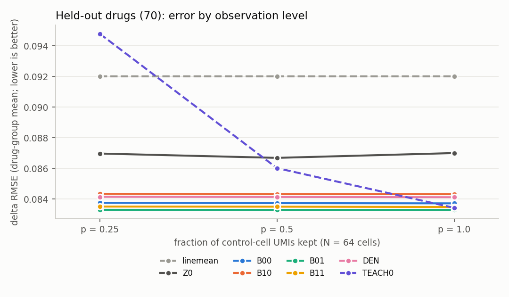
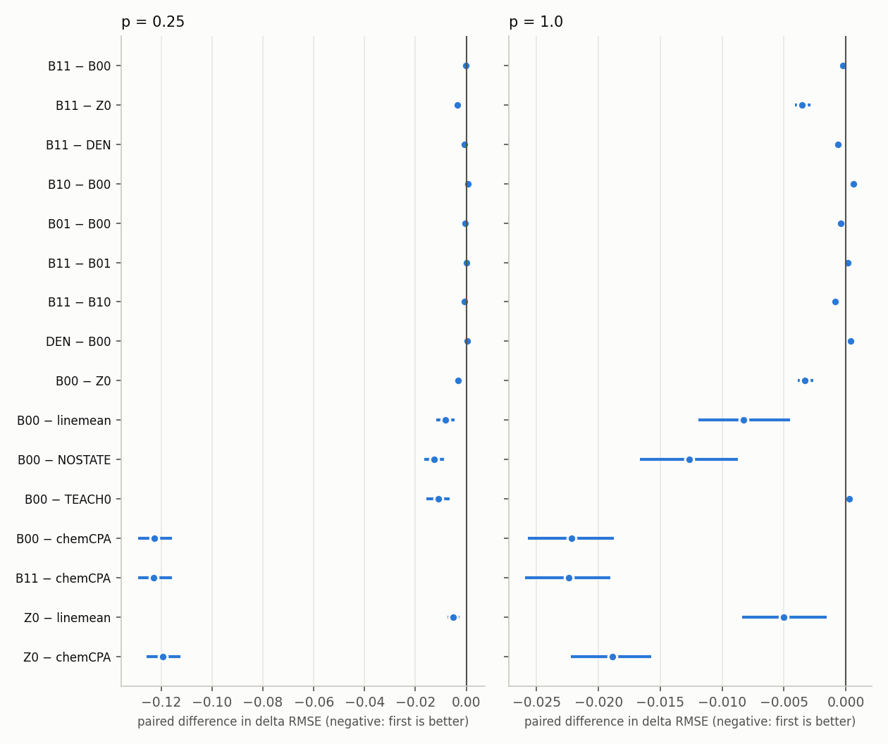

# R6 결과: 대조군을 덜 읽어도 약물 반응 예측이 유지되는가

2026-11-18. 과제: Tahoe-100M 0.5 µM에서 **학습에 없던 약물**의 평균 RNA 변화(유전자 2,000개)를, 같은 plate·세포주의 대조군 세포 64개와 약물 구조로 예측한다.
이번에는 그 대조군 세포의 UMI를 100% / 50% / 25%만 남겨(count 박화) 입력으로 준다. 정답은 바꾸지 않는다.

사전 규칙은 [PROTOCOL.md](PROTOCOL.md), 실행 전 기록은 [DECISIONS.md](DECISIONS.md), 노출 기록은 [EXPOSURE.md](EXPOSURE.md), 주장 범위는 [CLAIMS_AND_LIMITATIONS.md](CLAIMS_AND_LIMITATIONS.md),
모든 실행은 [RUN_LEDGER.tsv](RUN_LEDGER.tsv), 쉬운 설명은 [BEGINNER_SUMMARY.md](BEGINNER_SUMMARY.md)에 있다.

**이 평가는 blind test가 아니다.** 같은 공개 자료의 시험 약물 70개를 이전 연구들이 이미 채점했다. 이번 결과는 설정을 동결한 뒤 한 번 실행한, 사전에 고정한 후속 평가다.

## 0. 한 문단 요약

- 박화 증강만 넣은 기본 모델(B00)이 이미 깊이에 강건했다. 시험 약물에서 p=0.25 오차 0.0838, p=1.0 오차 0.0837로 차이가 0.04%다.
- 관측 신뢰도 입력(B10), teacher 기반 반응 보존 학습(B01, B11), 발현 재구성(DEN) 중 어느 것도 B00과 1% 이상 다르지 않았다. **사전 판정 규칙에 따라 이 모듈들의 추가 가치는 확인되지 않았다.**
- 증강이 없으면 같은 모델이 p=0.25에서 13% 나빠진다(0.0948). 깊이 문제는 실재했고, 단순 증강이 그것을 해결했다.
- B00은 같은 입력의 Ridge(Z0, 0.0870)보다 3.7% 좋고 세포주 평균(0.0920)보다 9.0% 좋다. 이 차이는 중간에 한 번 고친 반응 head(모든 arm 공통)가 있어야 나온다.
- 적용한 결론 줄(기획서 8절): "모든 방법이 같으면 현재 깊이·평균 반응 과제에서는 더 복잡한 구성이 필요하지 않다"와 "B01≈B11이면 입력 변경이 필수라고 주장하지 않는다".

## 1. 여섯 가지 질문

### 질문 1. 학습 예시 하나는 실제로 무엇인가

| 항목 | 내용 |
|---|---|
| 행 하나 | (세포주, 약물 구조 그룹) 조건 하나. 예: SNU-423에 약물 A를 0.5 µM로 처리 |
| 입력 | 그 조건과 같은 plate·세포주의 DMSO 대조군 세포 64개의 정수 UMI(유전자 2,000개 + 나머지 유전자 합). 학습 때는 매번 p ∈ {1, 0.5, 0.25} 중 하나로 박화한다. 그리고 약물의 ECFP4 지문 |
| 정답 | 실제로 측정한 처리 후 평균 발현 − 기준 대조군 평균. 항상 전체 관측으로 계산하고 p와 무관하다 |
| 독립 표본 단위 | **약물 구조 그룹**(그 약물의 모든 세포주를 한 묶음으로). 세포 수, 박화 seed, 학습 seed는 독립 표본이 아니다 |
| 모델이 모르는 것 | 박화 비율 p 자체. 관측된 library size와 검출 유전자 수만 볼 수 있다(B10, B11, DEN) |

대조군 세포는 pool마다 바코드 hash 순으로 세 역할로 나눴다: 평가 입력 64개, 학습 입력 최대 256개, 나머지는 정답 쪽 기준 대조군. 서로 바코드가 겹치지 않지만 **같은 well에서 나온 세포**다.

### 질문 2. 무엇을 학습에서 숨겼나

- 숨긴 것: **약물**. 시험 약물 그룹 70개(조건 3,283개, 세포주 48개)의 처리군은 입력, 정규화, teacher, 설정 선택 어디에도 쓰지 않았고 동결 커밋 뒤 한 번 읽었다.
- 숨기지 않은 것: **세포주와 plate**. 시험 조건의 대조군 pool은 학습 조건과 공유한다. 새 세포 상태나 새 실험 batch로의 일반화는 시험하지 않았다.
- 별도 실험이 아니다. 낮은 깊이로 실제 측정한 자료는 없고, 같은 세포의 count를 계산으로 줄였다.
- 설정 선택은 train 약물 209개 안의 fold(학습 130개, 개발 79개)에서만 했다. validation 약물 70개는 쓰지 않았다.

### 질문 3. 최선의 단순 기준선과 공개 모델을 같은 조건에서 이겼는가

시험 약물 70개, 주지표 ΔRMSE(조건별 → 약물 안 평균 → 약물 평균, 낮을수록 좋음). 신경망은 학습 seed 3개 × 박화 seed 3개 평균. 괄호는 약물 그룹 bootstrap 95% 구간.

| 모델 | p=0.25 | p=0.5 | p=1.0 |
|---|---|---|---|
| 무변화 | 0.1041 | 0.1041 | 0.1041 |
| 세포주 평균 | 0.0920 | 0.0920 | 0.0920 |
| Z0 (Ridge, 박화 증강) | 0.0870 | 0.0867 | 0.0870 |
| **B00** 기본 입력 + 증강 | **0.0838** [0.0757, 0.0935] | 0.0837 | 0.0837 |
| B10 관측 입력 + 증강 | 0.0844 | 0.0843 | 0.0843 |
| B01 기본 입력 + teacher | 0.0833 | 0.0833 | 0.0833 |
| B11 관측 입력 + teacher | 0.0835 | 0.0835 | 0.0835 |
| Denoise-control (DEN) | 0.0842 | 0.0841 | 0.0841 |
| No-state (약물만) | 0.0964 | 0.0964 | 0.0964 |
| 증강 없는 모델 (TEACH0) | 0.0948 | 0.0860 | 0.0834 |
| 공개 참조 chemCPA (재학습 안 함) | 0.2064 | 0.1424 | 0.1059 |

짝 차이(앞 − 뒤, 음수면 앞이 좋음). "규칙 충족"은 구간이 0을 제외하고 상대 차이가 1% 이상일 때다.

| 비교 | p=0.25 차이 [95% 구간] | 상대 | p=1.0 차이 [95% 구간] | 상대 | 규칙 충족 |
|---|---|---|---|---|---|
| B11 − B00 | −0.00025 [−0.00035, −0.00015] | −0.29% | −0.00024 [−0.00034, −0.00014] | −0.28% | 아니오 |
| B01 − B00 | −0.00046 [−0.00055, −0.00037] | −0.54% | −0.00042 [−0.00052, −0.00034] | −0.51% | 아니오 |
| B10 − B00 | +0.00059 [+0.00034, +0.00082] | +0.70% | +0.00060 [+0.00038, +0.00080] | +0.71% | 아니오 |
| DEN − B00 | +0.00039 [+0.00016, +0.00060] | +0.47% | +0.00040 [+0.00021, +0.00058] | +0.48% | 아니오 |
| B11 − B01 | +0.00021 [+0.00014, +0.00028] | +0.25% | +0.00019 [+0.00010, +0.00027] | +0.22% | 아니오 |
| B11 − DEN | −0.00064 [−0.00084, −0.00042] | −0.76% | −0.00064 [−0.00082, −0.00045] | −0.76% | 아니오 |
| B11 − Z0 | −0.00346 [−0.00490, −0.00198] | −3.98% | −0.00352 [−0.00414, −0.00288] | −4.05% | 예 |
| B00 − Z0 | −0.00321 [−0.00470, −0.00169] | −3.70% | −0.00328 [−0.00389, −0.00263] | −3.77% | 예 |
| B00 − 세포주 평균 | −0.00825 [−0.01182, −0.00453] | −8.97% | −0.00829 [−0.01190, −0.00452] | −9.01% | 예 |
| B00 − No-state | −0.01265 [−0.01659, −0.00877] | −13.1% | −0.01268 [−0.01665, −0.00874] | −13.2% | 예 |
| B00 − TEACH0 | −0.01103 [−0.01571, −0.00649] | −11.6% | +0.00029 [+0.00022, +0.00036] | +0.35% | p=0.25만 |
| B00 − chemCPA | −0.1226 [−0.1289, −0.1157] | −59% | −0.0222 [−0.0257, −0.0187] | −20.9% | 아래 주의 |

- **단순 기준선:** 예. B00(과 2×2의 나머지)은 Z0와 세포주 평균을 두 깊이 모두에서 규칙대로 이겼다. 세포주 48개 모두에서 B00이 Z0보다 낮다.
- **2×2 안:** 어떤 arm도 B00과 규칙대로 다르지 않다. B01과 B11은 구간이 0을 제외하지만 차이가 0.3–0.5%로 사전 기준 1%에 못 미친다. B10과 DEN은 오히려 0.5–0.7% 높다.
- **공개 모델(chemCPA):** p=1.0에서 B00이 21% 낮다. 다만 chemCPA는 박화 증강 없이 학습된 이전 연구의 고정 checkpoint이고 재학습하지 않았다.
  p<1에서 크게 나빠지는 것(0.14, 0.21)은 대부분 "얕게 읽은 세포를 넣고 전체 관측 기준 평균을 빼는" 계산에서 나온다(예측 크기가 실제의 2.1배). **p=0.5, 0.25의 chemCPA 수치는 공정한 승패로 세지 않는다.** p=1.0 값은 이전 연구의 수치(0.1062)와 일치한다.
- **State:** 실행하지 않았다(부적격, [DECISIONS.md](DECISIONS.md) D4). 이긴 모델에 넣지 않는다.
- **보호 지표(p=1.0):** 2×2와 DEN 모두 B00 대비 1% 한도 안이다(B10 +0.71%). 개발 fold에서는 B10이 +1.4%로 한도를 넘었었다.

### 질문 4. 개선은 어디에서 왔는가

| 변경 | 근거(시험 약물, p=0.25) | 해석 |
|---|---|---|
| 대조군 RNA 상태 입력 | B00 − No-state = −13.1% | 상태 입력이 필요하다(약물 구조만으로는 세포주 평균보다 나쁨) |
| count 박화 증강 | B00 − TEACH0 = −11.6% (p=1.0에서는 +0.35%) | 낮은 깊이에서의 이득은 증강에서 온다. 전체 관측 성능 비용은 0.35% |
| 반응 head 수정(수정 1, 모든 arm 공통) | 개발 fold에서 B00 0.0936 → 0.0802 (−14%) | 약물 특이 항의 과적합을 눌렀다. 기본 모델 변경이며 R6의 방법 효과가 아니다 |
| 관측 신뢰도 입력 | B10 − B00 = +0.70% | 이득 없음 |
| teacher 반응·latent 일치 | B01 − B00 = −0.54%, B11 − B00 = −0.29% | 기준 미달. p=1.0에서도 같은 크기이므로 깊이에 특이한 효과가 아니다 |
| 발현 재구성 | DEN − B00 = +0.47% | 이득 없음 |

사전 규칙상 B00보다 규칙대로 좋은 모듈이 없으므로 **추가 귀속(제거) 실험은 실행하지 않았다.**

### 질문 5. 무엇이 단순한 상관·보정이고 기전 증명이 아닌가

- 상태 입력의 이득은 "세포주 + plate/pool 수준의 평균 반응"을 맞히는 데서 온다. Ridge에서 약물 블록 벌점은 격자 끝까지 커졌고(약물 정보를 사실상 끔), 수정 1도 약물 특이 항을 강하게 눌러야 좋아졌다.
- 각자 평균을 뺀 ΔPearson(B00 0.42)과 retrieval 점수(0.80)는 약물 블록이 꺼진 Z0에서도 0.34 / 0.78이다. 즉 이 값들은 약물별 생물학보다 **같은 pool을 공유하는 조건들의 공통 성분**을 주로 반영한다. Top-1 retrieval은 6%다.
- 입력 세포와 정답의 기준 대조군은 같은 well에서 나왔다. 모델이 대조군 쪽 오차 성분을 맞혀서 Δ 오차가 줄었을 가능성을 배제하지 못한다(**검증하지 않은 가설**).
- 예측 크기는 실제의 0.65배다. 모델은 평균 쪽으로 줄여서 예측한다.
- 약물 표적, 경로, 인과 기전에 대한 증거는 없다.

### 질문 6. 남은 한계와 다음 결정 하나

- 합성 박화다. 실제로 얕게 측정한 독립 자료에서 확인하지 않았다. 주장 범위는 "합성 관측 감소에 대한 강건성"이다.
- Tahoe 세포는 전체 관측에서도 얕다(library 중앙값 1,882 UMI). p=0.25는 중앙값 471 UMI, panel 검출 유전자 165개다. 더 낮은 깊이는 시험하지 않았다.
- 단일 용량, 2,000 유전자, 평균 반응, 세포 64개. 본 적 있는 세포주·plate만.
- 학습률 선택값 일부와 수정 1의 λ가 격자 끝이다. 수정 1의 이득이 어디서 오는지(encoder인지 head인지)는 분해하지 않았다.
- **다음 결정 하나:** R6의 추가 모듈(관측 신뢰도 입력, teacher, 재구성) 개발을 여기서 종료하고, 이후 연구의 기본값으로 "박화 증강 + 수정된 head"만 채택할지 결정한다. 권고는 종료다.

## 2. 진행 경과와 진단

### 2.1 원자료와 계약

- raw integer count를 직접 읽었다(DMSO 세포 916,988개, 값 13.6억 개, 비정수 0, 음수 0). 기존 log 배열을 UMI로 되돌리지 않았다. [`raw_count_receipt.json`](../../manifests/depth_robust_r6/raw_count_receipt.json)
- pool 250개 중 세포 256개 이상인 234개를 썼다. 유효 조건은 16,521 → 16,264개(257개 제외). 정답을 기준 대조군으로 다시 계산해 생긴 변화는 RMS 0.012(정답 RMS 0.114).
  [`DATA_CONTRACT.json`](../../manifests/depth_robust_r6/DATA_CONTRACT.json)

### 2.2 R6-0 관측 진단 (대조군만, [표](tables/r6_0_observation.json))

| 보기 | library 중앙값 | panel 검출 유전자 | 토큰 256개 미만 세포 | 집합 평균 이동 (pool 사이 SD 단위) | 가장 가까운 pool 맞힘 (원값) |
|---|---|---|---|---|---|
| p=1.0, N=64 | 1,882 | 490 | 4% | 0 | 100% |
| p=0.5, N=64 | 940 | 293 | 39% | 0.63 | 100% |
| p=0.25, N=64 | 471 | 165 | 79% | 1.13 | 59–61% |
| p=1.0, N=16 | 1,882 | 490 | 4% | 0.72 | 100% |

평균 이동을 빼면 p=0.25에서도 pool을 100% 맞힌다. 정보는 남아 있고 척도가 이동한다. 그래서 전체 관측만으로 맞춘 Ridge는 p=0.25에서 0.0825 → 0.0992로 나빠지고, 증강하면 0.0831로 돌아온다(개발 fold).

### 2.3 pilot과 수정 (개발 fold, [표](tables/pilot_runs.tsv), [곡선](tables/pilot_curves.tsv))

1. **처음 head:** 모든 신경망 arm이 0.092–0.099로 세포주 평균(0.0895)보다 나빴다. teacher 판정 실패.
2. **수정 1(사전 기록 D7):** head를 `Δ = g(상태) + h(상태, 약물)`로 나누고 h의 크기에 벌점(λ=10). B00 0.0936 → 0.0803. 모든 arm에 적용.
3. **수정 뒤:** teacher 판정 통과(0.0796, 0.0802). B00 0.0802, B01 0.0795, B11 0.0797, B10 0.0813, DEN 0.0810. 증강 없는 teacher는 p=0.25에서 0.0918.
4. **수정 2는 쓰지 않았다(D9).** 허용된 수정 사유가 관측되지 않았고 B00의 깊이 간 차이가 0.2%뿐이었다.

개발 fold 수치는 설정 선택에 쓴 값이다. 시험 약물 결과와 방향·크기가 같다(B01 −0.8% → −0.5%, B10 +1.4% → +0.7%).

### 2.4 SNU-423 (사전 지정, 약물 70개, [표](tables/final_snu423.tsv))

| 모델 | p=0.25 | p=1.0 |
|---|---|---|
| 무변화 | 0.1121 | 0.1121 |
| 세포주 평균 | 0.0989 | 0.0989 |
| Z0 | 0.0947 | 0.0953 |
| B00 | 0.0921 [0.0831, 0.1030] | 0.0921 |
| B10 | 0.0926 | 0.0926 |
| B01 | 0.0915 | 0.0915 |
| B11 | 0.0918 | 0.0919 |
| DEN | 0.0926 | 0.0926 |
| No-state | 0.1022 | 0.1022 |
| TEACH0 | 0.1016 | 0.0918 |
| chemCPA | 0.2219 | 0.1141 |

짝 차이(p=0.25): B11 − B00 −0.00027 [−0.00049, −0.00006], B01 − B00 −0.00064 [−0.00083, −0.00045], B10 − B00 +0.00049 [+0.00019, +0.00078],
B00 − Z0 −0.00258 [−0.00388, −0.00122], B00 − TEACH0 −0.00951 [−0.01431, −0.00479]. 전체와 같은 양상이다. 세포주 하나이며 환자 HCC로 일반화하지 않는다.
HepG2/C3A(CVCL_1098)는 유래가 다른 세포주로 따로 둔다: B00 0.0822, Z0 0.0862.

### 2.5 보조 지표 (시험 약물, p=0.25 / p=1.0)

| 모델 | ΔPearson | 각자 평균을 뺀 ΔPearson | Top-20 방향 | 예측 크기 비 | retrieval 점수 (0.5 = 우연) |
|---|---|---|---|---|---|
| 세포주 평균 | 0.49 / 0.49 | 0 / 0 | 0.87 / 0.87 | 0.56 / 0.56 | 0.50 / 0.50 |
| Z0 | 0.55 / 0.55 | 0.34 / 0.35 | 0.89 / 0.89 | 0.56 / 0.66 | 0.78 / 0.78 |
| B00 | 0.59 / 0.59 | 0.42 / 0.42 | 0.90 / 0.90 | 0.65 / 0.65 | 0.80 / 0.80 |
| B11 | 0.59 / 0.59 | 0.43 / 0.43 | 0.91 / 0.91 | 0.64 / 0.65 | 0.80 / 0.80 |
| DEN | 0.58 / 0.58 | 0.41 / 0.41 | 0.90 / 0.90 | 0.64 / 0.64 | 0.80 / 0.80 |
| TEACH0 | 0.44 / 0.60 | 0.21 / 0.43 | 0.87 / 0.91 | 0.47 / 0.65 | 0.72 / 0.81 |
| chemCPA | 0.24 / 0.40 | 0.25 / 0.25 | 0.52 / 0.83 | 2.13 / 0.87 | 0.77 / 0.78 |

보조 지표는 선택에 쓰지 않았다. 전체 표는 [`final_main.tsv`](tables/final_main.tsv), 세포주별은 [`final_by_line.tsv`](tables/final_by_line.tsv), 조건별은 `predictions/depth_robust_r6/final_per_condition_rmse.tsv.gz`.

### 2.6 비용

| 모델 | 파라미터 | 학습 시간 (A40, GPU 하나에 3개 동시) | 최대 VRAM |
|---|---|---|---|
| B00 / TEACH0 | 5.09M | 34분 | 6.4 GB |
| B10 | 6.13M | 23분 | 6.4 GB |
| B01, B11 (+ teacher 1회 학습) | 5.11M, 6.15M | 29분 + teacher 34분 | 8.8 GB |
| DEN | 6.39M | 23분 | 6.5 GB |
| No-state | 3.76M | 1분 | 0.5 GB |
| Z0 | — | 17초 | — |

teacher arm은 teacher 학습까지 합치면 B00의 약 두 배가 든다. 전체 GPU 사용은 약 11 GPU-시간(취소·실패 포함, 로그 기준 추정), CPU 작업은 약 4 core-시간 이하다.

### 2.7 그림

## 3. 실행하지 않은 것과 실패한 실행

- **State:** 부적격(공개 가중치의 시험 약물 노출, 정답까지 박화하는 downsampling 경로, 새 약물 입력 경로 미지원, 연산). 실행하지 않음.
- **귀속 실험, 수정 2:** 사전 규칙의 조건이 충족되지 않아 실행하지 않음.
- **chemCPA 재학습(증강 포함):** 하지 않음. 외부 모델은 고정 checkpoint 하나로 정했다.
- **신경망의 N=16, 더 낮은 p, 토큰 수 변경:** 하지 않음(주 계약 밖).
- **취소 16건:** pilot을 개별 작업 18개로 한꺼번에 제출해 약 2분 동안 GPU 14개가 동시에 돌았다(한도 2개). 16개를 취소하고 2-GPU 배열로 다시 제출했다.
- **실패 3건:** 24 GB GPU 하나에 실행을 너무 많이 묶어 메모리 부족. 같은 설정으로 다시 실행했다. 모두 [RUN_LEDGER.tsv](RUN_LEDGER.tsv)에 있다.

## 4. 재현

- 동결: `manifests/depth_robust_r6/freeze_manifest.json` (동결 커밋 `8f4495b`, 코드 커밋 `5ca8b9d`).
- 권고 모델(B00) checkpoint: 서버 worktree의 `assets/runs/final/final_B00_s42/ckpt.pt`, sha256 `2362e3ea1124ce19763b3177308fe6d4b2f6a89569b929a64353880c3094aa8e`. 나머지 checkpoint의 해시는 RUN_LEDGER.tsv에 있다. 가중치와 예측 배열은 Git에 올리지 않았다.
- 노트북: [`tutorials/depth_robust_r6/01_thinning_and_results.ipynb`](../../tutorials/depth_robust_r6/01_thinning_and_results.ipynb) (커밋된 표만 읽음, 실행 결과 저장됨).
