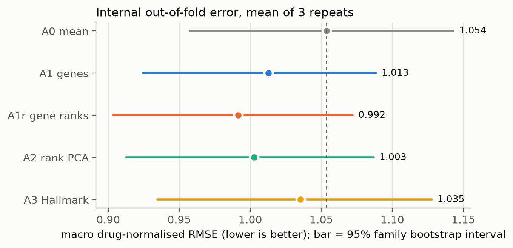
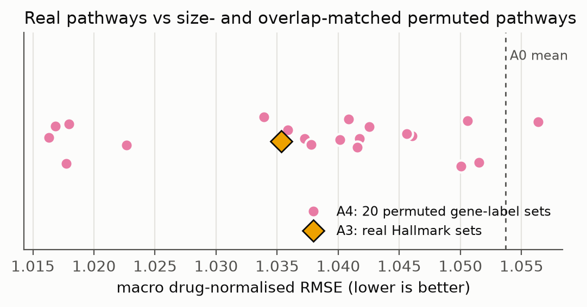
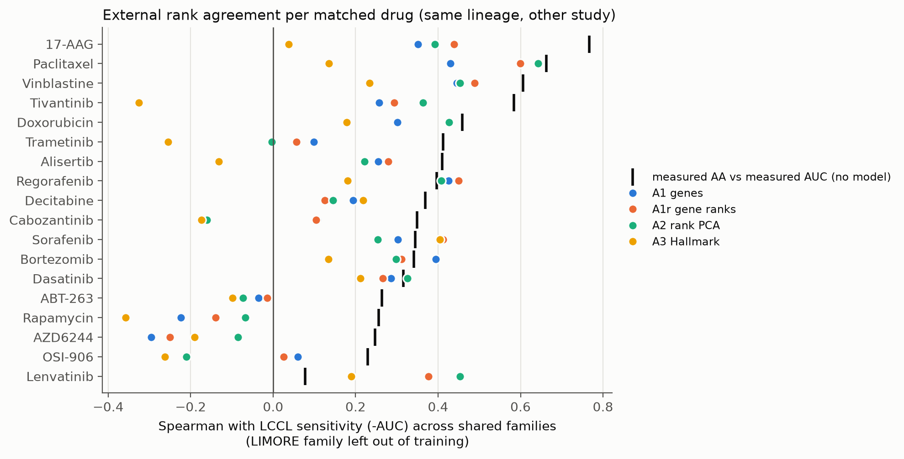

# 연구 A 결과 요약: 소표본 간암 약물 민감도 예측에서 경로 표현

작성일 2026-11-16. 최종 상태: **내부 평가 완료(경로 표현의 추가 가치 미확인), 외부 평가는 `external_validation_limited`**.

## 1. 무엇을 물었나

간암 세포 모델에 약을 처리하기 전의 RNA만 보고, 그 모델이 약에 얼마나 민감할지 예측하려고 합니다. 세포 모델은 79개뿐이고 유전자는 약 19,000개입니다. 표본이 이렇게 적을 때 유전자 값을 이미 알려진 생물학적 경로 50개(MSigDB Hallmark)의 점수로 줄여 넣으면 예측이 더 정확해지는지 확인했습니다.

경로 점수가 좋아 보이더라도 그 이유가 "경로 지식" 때문인지, 단순히 순위로 바꾸었기 때문인지, 차원을 줄였기 때문인지 구분해야 합니다. 그래서 같은 예측기(Ridge)에 입력 표현만 바꾸어 넣었습니다.

| 이름 | 입력 | 확인하려는 것 |
|---|---|---|
| A0 | 입력 없음. 학습 자료의 약물별 평균 | 기준선 |
| A1 | 유전자 log2 FPKM 19,018개 | 유전자 값 그대로 |
| A1r | 표본 안에서 유전자 순위로 바꾼 값 | 순위화의 효과 |
| A2 | 순위 값을 PCA로 줄인 값(40~41차원) | 경로 지식 없는 압축의 효과 |
| A3 | Hallmark 50개 경로의 singscore | 알려진 경로 구성 |
| A4 | 유전자 이름을 무작위로 섞어 만든 가짜 경로 50개(20회) | 경로 구성 자체의 효과 |

## 2. 자료

- **LIMORE**(Qiu 외 2019): 간암 세포 모델 81개 중 간모세포종 2개(HepG2, Huh6)를 제외한 **79개 모델, 76개 계열, 약물 90개**입니다. 같은 환자나 같은 조상에서 나온 모델은 한 계열로 묶었습니다. 결측 쌍은 없습니다.
- **정답**은 Activity Area(AA)이며 값이 클수록 민감합니다. IC50, Emax와의 방향을 자료에서 확인했습니다.
- **외부 자료 LCCL**(Caruso 외 2019): 32개 세포주, 대응 약물 18개입니다. 이 중 27개 모델(26개 계열)은 LIMORE에도 있는 계열이고, LIMORE에 없는 계열은 5개 모델(4개 계열)뿐입니다.

자세한 출처와 확인하지 못한 항목은 [DATA_CARD.md](DATA_CARD.md)에 있습니다.

## 3. 어떻게 평가했나

- 같은 계열이 학습과 시험에 동시에 들어가지 않도록 계열 단위 5겹 교차검증을 3회 반복했습니다. Ridge의 규제 강도는 학습 쪽 안에서만 다시 3겹으로 골랐습니다.
- 주지표는 `macro_drug_normalized_rmse`입니다. 약물마다 오차를 학습 자료의 표준편차로 나누고, 약물 90개를 같은 비중으로 평균합니다. 낮을수록 좋습니다. 반복마다 점수를 계산한 뒤 평균했습니다.
- 불확실성은 계열을 단위로 2,000회 다시 뽑는 bootstrap의 95% 구간으로 나타냈습니다.
- 모든 규칙은 점수를 보기 전에 `configs/pathway_sensitivity_a1/analysis.yaml`에 고정했고, 이후 수정한 항목은 없습니다.

방법 전체는 [METHODS.md](METHODS.md)에 있습니다.

## 4. 결과

### 내부 평가(LIMORE)

| 표현 | 주지표 | 95% 구간 | A0과의 차이 [95% 구간] | A0보다 나은 약물 수 |
|---|---|---|---|---|
| A0 평균 | 1.054 | 0.958 ~ 1.143 | – | – |
| A1 유전자 | 1.013 | 0.924 ~ 1.088 | −0.041 [−0.083, +0.002] | 69 / 90 |
| A1r 유전자 순위 | 0.992 | 0.903 ~ 1.072 | −0.062 [−0.090, −0.031] | 75 / 90 |
| A2 순위 PCA | 1.003 | 0.912 ~ 1.087 | −0.051 [−0.074, −0.026] | 67 / 90 |
| A3 Hallmark 경로 | 1.035 | 0.935 ~ 1.128 | −0.018 [−0.046, +0.010] | 54 / 90 |

- 경로 표현(A3)은 평균 기준선보다 약간 낮았지만 차이의 구간이 0을 포함합니다.
- A3는 유전자 순위(A1r)와 순위 PCA(A2)보다 **나빴고**, 이 차이의 구간은 0을 포함하지 않습니다(A3−A1r +0.044 [+0.023, +0.062], A3−A2 +0.033 [+0.013, +0.050]). A1과의 차이는 +0.023 [−0.016, +0.058]입니다.
- 사전에 정한 개선 판정 기준(A3가 A0과 A1보다 낮고 두 차이의 구간이 모두 0 아래)을 **충족하지 못했습니다.**
- 평균 기준선보다 구간까지 낮았던 표현은 A1r과 A2입니다. 다만 개선 폭은 주지표의 약 5~6%입니다.

### 무작위 경로 대조와 학습곡선(소규모 진단)

판정 기준을 충족하지 못했으므로 두 분석은 계획대로 한 번만 실행했고 `small_diagnostic_gate_not_met`으로 표시했습니다.

- 실제 경로 A3 1.0353, 무작위 경로 20회 평균 1.0372(최소 1.0163, 최대 1.0564)입니다. 20회 중 6회가 실제 경로와 같거나 더 좋았습니다. 차이는 −0.002 [−0.020, +0.017]입니다.
- 학습 계열을 절반(30~31개)으로 줄였을 때 A3 1.057, A0 1.056, A1 1.044, A1r 1.013, A2 1.026입니다. 표본이 더 적을 때 경로 표현이 유리해지는 양상은 관찰되지 않았습니다.

### 외부 평가(LCCL)

LCCL은 측정 방식이 달라서(AUC, 방향 반대) 값의 크기를 맞추지 않고 약물별 순위 일치도(Spearman)만 보았습니다.

| 표현 | 같은 계열·다른 연구 측정(26계열, 18약물) 평균 Spearman [95% 구간] | 양수인 약물 수 |
|---|---|---|
| A1 | 0.212 [0.048, 0.353] | 15 / 18 |
| A1r | 0.236 [0.104, 0.355] | 15 / 18 |
| A2 | 0.210 [0.079, 0.329] | 12 / 18 |
| A3 | 0.007 [−0.157, 0.170] | 10 / 18 |

- 참고로, 모델 없이 두 연구의 실측값끼리 비교한 일치도는 평균 0.394 [0.256, 0.505]입니다. 예측의 일치도는 이 값을 넘기 어렵습니다.
- LIMORE에 없는 **새 계열은 5개 모델(4개 계열)뿐**이어서 구간이 매우 넓고(예: A3 0.066 [−0.333, 0.667]) 결론을 낼 수 없습니다. 그래서 외부 평가 상태를 `external_validation_limited`로 둡니다.

## 5. 의미

기획서 7.3절 판단표를 문자 그대로 적용하면 다음과 같습니다.

- "A3가 무작위 경로와 비슷함"에 해당하므로 결론은 **"알려진 경로 구성의 추가 가치 미확인"**입니다.
- "A3가 A1·A1r·A2 및 A4보다 안정적으로 좋음"과 "A3가 A1만 이기고 A1r/A2와 비슷함"에는 해당하지 않습니다.
- "모든 표현이 A0와 비슷함"에는 해당하지 않습니다. A1r과 A2는 구간까지 A0보다 낮았습니다. A1과 A3는 구간이 0을 포함합니다.

이 결론은 이번 구성, 곧 LIMORE 79개 모델, AA 정답, Hallmark 50개 경로, singscore, Ridge, 계열 단위 교차검증에 한정됩니다. 다른 경로 모음, 다른 점수 방식, 다른 예측기, 다른 정답에 대해서는 이 실험이 말해 주는 것이 없습니다. 주장과 한계의 구분은 [CLAIMS_AND_LIMITATIONS.md](CLAIMS_AND_LIMITATIONS.md)에, 약물별·계열별 결과와 점검 결과는 [RESULTS.md](RESULTS.md)에 있습니다.

## 6. 직접 따라 하기

`tutorials/pathway_sensitivity_a1/`의 노트북 네 개를 순서대로 실행하면 자료 읽기, 표현 비교, 한 약물 예측, 저장된 결과로 표와 그림 다시 만들기를 따라 할 수 있습니다. 노트북을 열어도 전체 학습은 실행되지 않습니다. 전체 실행 명령은 METHODS.md 8절에 있습니다.
