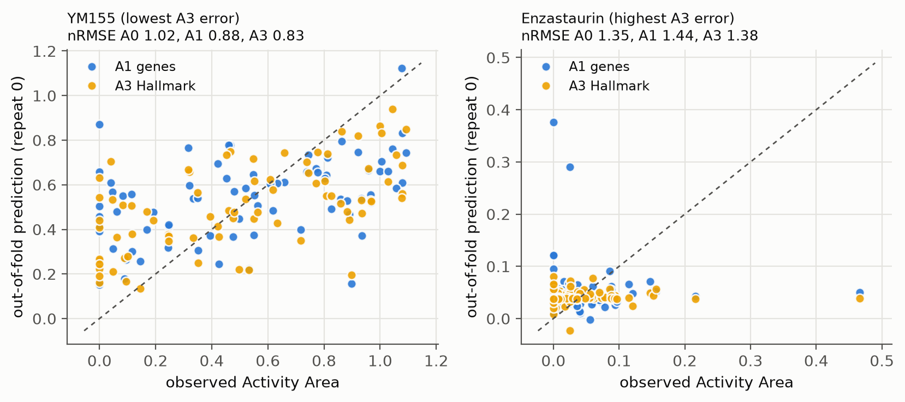
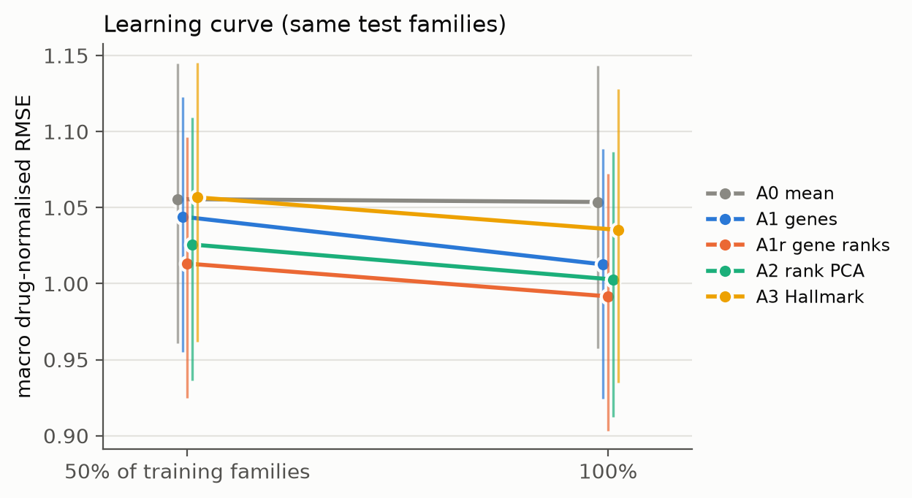

# 연구 A 결과

작성일 2026-11-16. 이 문서의 모든 수치는 `reports/pathway_sensitivity_a1/tables/`의 표에서 가져왔습니다. 실행 ID는 `oof/RUNS.json`에 있습니다(내부 `a2_main_d284715`, 대조 `a3_controls_45aa42a`, 외부 `a4_external_45aa42a`). 분석 규칙은 점수를 보기 전에 커밋 `606d065`에서 고정했고 수정 기록(`amendments`)은 비어 있습니다.

## 1. 평가 대상

| 항목 | 값 |
|---|---|
| LIMORE 포함 모델 | 79 (81개 중 HepG2, Huh6 제외) |
| 계열(family) | 76. 두 모델로 된 계열은 CLC19/CLC20, HLE/HLF, PLC8024/PLCPRF5 |
| 약물 | 90. 결측 쌍 0, 반응이 상수인 약물 0 |
| 유전자 축 | 19,018 |
| 경로 | Hallmark 50개(제외 없음) |
| 바깥 교차검증 | 계열 단위 5겹 × 3회. 학습 쪽 62~64개 모델(60~61개 계열) |
| A2 차원 | 겹마다 40 또는 41 |

## 2. 내부 평가: 주지표

`macro_drug_normalized_rmse`는 반복 3회 각각의 점수를 평균한 값입니다. 구간은 계열 bootstrap 2,000회의 95% 구간입니다.

| 표현 | 주지표 | 95% 구간 | 반복 0 | 반복 1 | 반복 2 | 반복 간 SD | 약물별 Spearman 평균 |
|---|---|---|---|---|---|---|---|
| A0 | 1.0537 | 0.958 ~ 1.143 | 1.047 | 1.060 | 1.054 | 0.006 | (해석하지 않음) |
| A1 | 1.0126 | 0.924 ~ 1.088 | 1.049 | 0.990 | 0.999 | 0.032 | 0.299 |
| A1r | 0.9916 | 0.903 ~ 1.072 | 0.990 | 0.989 | 0.997 | 0.004 | 0.302 |
| A2 | 1.0027 | 0.912 ~ 1.087 | 0.998 | 1.002 | 1.009 | 0.005 | 0.247 |
| A3 | 1.0353 | 0.935 ~ 1.128 | 1.026 | 1.033 | 1.047 | 0.011 | 0.175 |

읽을 때 주의할 점은 다음과 같습니다.

- A0이 1보다 큰 것은 정상입니다. 시험 계열을 빼고 구한 평균으로 예측하고, 분모는 학습 자료의 표준편차이기 때문입니다.
- A0의 Spearman(−0.19)은 의미가 없습니다. A0의 예측은 겹 안에서 상수이고, 겹 사이의 차이는 시험 계열을 뺀 효과만 반영합니다.
- 개별 표현의 구간은 넓고 서로 겹칩니다. 표현 간 비교는 같은 계열을 함께 다시 뽑은 **차이의 구간**(3절)으로 해야 합니다.
- A1은 반복 간 편차가 다른 표현보다 큽니다(SD 0.032).
- 반복 3회의 예측을 먼저 평균한 뒤 채점한 값은 이름을 따로 붙였습니다(`ensemble_of_repeats_macro_nrmse`: A0 1.016, A1 0.962, A1r 0.951, A2 0.958, A3 0.988). 이 값은 주지표가 아닙니다.

## 3. 내부 평가: 표현 간 차이

음수이면 앞의 표현이 더 좋습니다.

| 비교 | 차이 | 95% 구간 | 앞 표현이 나은 약물 수 |
|---|---|---|---|
| A1 − A0 | −0.041 | −0.083 ~ +0.002 | 69 / 90 |
| A1r − A0 | −0.062 | −0.090 ~ −0.031 | 75 / 90 |
| A2 − A0 | −0.051 | −0.074 ~ −0.026 | 67 / 90 |
| A3 − A0 | −0.018 | −0.046 ~ +0.010 | 54 / 90 |
| A3 − A1 | +0.023 | −0.016 ~ +0.058 | 30 / 90 |
| A3 − A1r | +0.044 | +0.023 ~ +0.062 | 13 / 90 |
| A3 − A2 | +0.033 | +0.013 ~ +0.050 | 17 / 90 |
| A1r − A1 | −0.021 | −0.048 ~ +0.004 | 65 / 90 |
| A2 − A1r | +0.011 | +0.003 ~ +0.018 | 13 / 90 |

**사전 고정 판정 기준의 적용.** 기준은 "A3의 주지표가 A0과 A1보다 낮고, (A3 − A0)과 (A3 − A1)의 95% 구간이 모두 0 아래"입니다. A3는 A0보다 낮지만 구간이 0을 포함하고, A1보다는 높습니다. 따라서 기준을 **충족하지 못했습니다.**

## 4. 약물별 결과

표는 `tables/internal_per_drug.tsv`(약물별 평균)와 `tables/internal_per_drug_per_repeat.tsv`에 있습니다.

| 표현 | 정규화 RMSE가 1보다 낮은 약물 수 | Spearman이 양수인 약물 수 | 다섯 표현 중 가장 낮은 약물 수 |
|---|---|---|---|
| A0 | 0 | – | 12 |
| A1 | 40 | 82 | 21 |
| A1r | 50 | 82 | 51 |
| A2 | 38 | 76 | 2 |
| A3 | 21 | 70 | 4 |

A3의 오차가 가장 낮은 약물과 가장 높은 약물입니다.

| 약물 | A0 | A1 | A1r | A2 | A3 |
|---|---|---|---|---|---|
| YM155 | 1.018 | 0.878 | 0.859 | 0.887 | 0.831 |
| Carfilzomib | 1.035 | 0.830 | 0.836 | 0.846 | 0.882 |
| BX-912 | 1.031 | 0.946 | 0.901 | 0.925 | 0.902 |
| Daporinad | 1.018 | 0.949 | 0.905 | 0.916 | 0.918 |
| Dasatinib | 1.026 | 0.868 | 0.853 | 0.842 | 0.925 |
| … | | | | | |
| Pazopanib | 1.165 | 1.169 | 1.149 | 1.177 | 1.169 |
| PD173074 | 1.205 | 1.271 | 1.123 | 1.137 | 1.188 |
| Ruxolitinib | 1.214 | 1.229 | 1.217 | 1.218 | 1.227 |
| Cabozantinib | 1.179 | 1.249 | 1.233 | 1.200 | 1.239 |
| Enzastaurin | 1.351 | 1.438 | 1.349 | 1.361 | 1.380 |

- A3가 평균 기준선보다 가장 많이 낮았던 약물은 YM155(−0.186), Carfilzomib(−0.153), BX-912(−0.129), AT-7519(−0.117), Dasatinib(−0.101)입니다. 이 약물들에서는 A1, A1r, A2도 함께 낮았습니다. A3가 다섯 표현 중 가장 낮았던 약물은 4개입니다.
- A3가 평균 기준선보다 가장 많이 높았던 약물은 Cabozantinib(+0.060), Avasimibe(+0.058), ABT-199(+0.052), Afatinib(+0.050), Olaparib(+0.048)입니다.
- 약물별 차이의 bootstrap 구간(다중 비교 보정 없음, 탐색적)에서, A3 − A0의 구간이 0 아래인 약물은 7개, 0 위인 약물은 7개입니다. A3 − A1은 0 아래 2개, 0 위 13개입니다. 보정하지 않은 값이므로 개별 약물에 대한 결론으로 쓰지 않았습니다.
- Enzastaurin은 대부분의 모델에서 AA가 0 근처이고 소수의 모델만 반응합니다(아래 그림). 오차가 가장 높은 다섯 약물에서는 표현 대부분이 평균 기준선과 비슷하거나 더 나빴습니다(예외: PD173074의 A1r, A2).

## 5. 계열별 결과와 실패 사례

표는 `tables/internal_per_family.tsv`입니다. 값은 계열별 정규화 RMSE(약물 90개 평균)입니다. 계열별 중앙값은 A0 0.913, A1 0.889, A1r 0.867, A2 0.859, A3 0.891입니다.

| 계열(모델) | A0 | A1 | A1r | A2 | A3 | 설명 |
|---|---|---|---|---|---|---|
| CLC13 | 2.657 | 2.335 | 2.481 | 2.538 | 2.681 | 모든 표현에서 오차가 가장 큼 |
| CLC22 | 1.611 | 1.699 | 1.734 | 1.686 | 2.006 | A3에서 특히 나쁨 |
| CLC30 | 1.780 | 1.657 | 1.598 | 1.669 | 1.690 | |
| SNU886 | 1.504 | 1.450 | 1.461 | 1.490 | 1.536 | |
| JHH5 | 1.343 | 1.452 | 1.443 | 1.474 | 1.483 | 모든 표현이 A0보다 나쁨 |
| SNU398 | 1.082 | 1.801 | 1.305 | 1.223 | 1.306 | A1에서 크게 나쁨 |
| JHH1 | 1.087 | 1.097 | 1.085 | 1.081 | 1.142 | 부분 오염 보고가 있어 표시한 모델 |
| CLC45 | 0.892 | 0.552 | 0.579 | 0.613 | 0.636 | RNA 표현이 가장 크게 도움이 된 계열 |

- 관찰: CLC13은 모든 표현에서 오차가 2.3 이상으로 가장 컸습니다.
- 관찰: SNU398에서는 유전자 값 그대로(A1)의 오차가 1.80으로, 순위(A1r 1.31)나 평균(1.08)보다 훨씬 큽니다. A1의 반복 간 편차가 큰 것과 같은 방향의 관찰입니다. 원인은 확인하지 않았습니다.
- 전체 평균은 소수의 오차가 큰 계열에 영향을 받습니다. 그래서 구간 계산의 단위를 계열로 두었습니다.

## 6. 대조 분석(소규모 진단)

3절의 판정 기준을 충족하지 못했으므로 A4와 학습곡선은 계획대로 한 번만 실행했고, 결과 파일에 `small_diagnostic_gate_not_met` 표시가 들어 있습니다(`tables/controls_results.json`).

### 6.1 무작위 경로(A4)

유전자 축에서 유전자 이름을 무작위로 바꾸어, 경로의 크기와 경로 간 겹침 구조는 그대로 두고 구성 유전자만 바꾼 가짜 경로 50개를 20번 만들었습니다(seed 101~120).

| 항목 | 값 |
|---|---|
| A3(실제 경로) | 1.0353 |
| A4 20회 평균 | 1.0372 |
| A4 최소 ~ 최대 | 1.0163 ~ 1.0564 |
| A4 20회의 SD | 0.0125 |
| A3와 같거나 더 좋은 무작위 경로 | 20회 중 6회 |
| A3 − A4 평균 | −0.0018, 95% 구간 −0.020 ~ +0.017 |
| A3가 A4 평균보다 나은 약물 | 45 / 90 |

실제 경로의 점수는 무작위 경로 20회의 분포 안쪽에 있습니다.

### 6.2 학습곡선

같은 시험 계열을 두고 학습 계열을 절반(30~31개)으로 줄였습니다. 점수는 전체 학습 자료의 표준편차로 정규화했습니다.

| 표현 | 50% | 100% |
|---|---|---|
| A0 | 1.0556 | 1.0537 |
| A1 | 1.0440 | 1.0126 |
| A1r | 1.0132 | 0.9916 |
| A2 | 1.0257 | 1.0027 |
| A3 | 1.0567 | 1.0353 |

50%에서의 차이는 A3 − A0 +0.001 [−0.028, +0.031], A3 − A1 +0.013 [−0.023, +0.047], A3 − A1r +0.044 [+0.025, +0.061], A3 − A2 +0.031 [+0.012, +0.051]입니다. (A3 − A1)의 50%와 100% 사이 차이는 −0.010 [−0.038, +0.016]입니다. 학습 계열이 적을 때 A3가 상대적으로 유리해진다는 양상은 구간 안에서 확인되지 않았습니다.

### 6.3 규제 강도 선택

겹 × 약물별로 선택된 alpha의 분포는 `tables/internal_alpha_counts.tsv`에 있습니다(표현마다 1,350건). A1과 A1r은 격자의 최댓값 10000이 가장 많이 선택되었고(961건, 896건), 최솟값 0.01도 215건, 278건 선택되었습니다. A3는 100~1000이 대부분입니다(574건, 464건). 격자의 양 끝이 자주 선택되었다는 점은 관찰로만 기록하며, 격자는 사전 고정값이므로 바꾸지 않았습니다.

## 7. 외부 평가(LCCL)

상태: **`external_validation_limited`**. LIMORE에 없는 새 계열이 5개 모델(4개 계열)뿐이기 때문입니다.

- 포함 LCCL 세포주 32개, 대응 약물 18개(`manifests/pathway_sensitivity_a1/drug_match_lccl.tsv`). 염 형태가 같은지는 확인하지 못했습니다.
- 채점은 약물별 Spearman(예측 AA, −AUC)이며 18개 약물을 평균했습니다. GI50은 보조입니다(42%가 상한값이어서 약물 17개 또는 15개만 채점됨).

### 7.1 같은 계열의 다른 연구 측정(26개 계열, 27개 모델)

해당 계열을 LIMORE 학습에서 빼고 학습한 모델로, LCCL의 RNA를 입력해 예측했습니다.

| 표현 | AUC 기준 평균 [95% 구간] | 중앙값 | 양수 약물 | GI50 기준 평균 [95% 구간] |
|---|---|---|---|---|
| A1 | 0.212 [0.048, 0.353] | 0.272 | 15 / 18 | 0.214 [0.065, 0.347] |
| A1r | 0.236 [0.104, 0.355] | 0.286 | 15 / 18 | 0.271 [0.133, 0.397] |
| A2 | 0.210 [0.079, 0.329] | 0.276 | 12 / 18 | 0.226 [0.088, 0.356] |
| A3 | 0.007 [−0.157, 0.170] | 0.086 | 10 / 18 | −0.025 [−0.172, 0.121] |
| 실측 AA 대 실측 −AUC(모델 없음) | 0.394 [0.256, 0.505] | 0.359 | – | – |

- 관찰: A1, A1r, A2의 순위 일치도는 구간이 0보다 위입니다. A3의 구간은 0을 포함합니다.
- 표현 간 외부 점수 **차이**의 bootstrap 구간은 계산하지 않았습니다(사전 계획에 없음). 따라서 "A3가 외부에서 A1r보다 낮다"는 것은 점추정의 비교입니다.
- 두 연구의 실측값끼리의 일치도가 0.39이므로, 이 평가에서 예측이 얻을 수 있는 값에는 측정 차이에 따른 한계가 있습니다.
- 약물별로는 Trametinib, AZD6244, Rapamycin, ABT-263, OSI-906에서 모든 표현의 일치도가 0 근처이거나 음수입니다(`tables/external_per_drug.tsv`).

### 7.2 새 계열(4개 계열, 5개 모델: HepaRG, B1, HCC-3, HCC-1.1/1.2)

| 표현 | AUC 기준 평균 [95% 구간] |
|---|---|
| A1 | 0.006 [−0.222, 0.294] |
| A1r | 0.068 [−0.222, 0.333] |
| A2 | 0.101 [−0.222, 0.412] |
| A3 | 0.066 [−0.333, 0.667] |

계열이 4개이므로 약물별 Spearman이 취할 수 있는 값이 몇 가지뿐이고 구간이 매우 넓습니다. 이 표로는 어느 표현이 낫다고 말할 수 없습니다. 개별 예측값은 `tables/external_new_lineage_predictions.tsv`에 있습니다.

## 8. 기획서 7.3절 판단표의 적용

| 판단표의 행 | 해당 여부 | 근거 |
|---|---|---|
| A3가 A1·A1r·A2 및 A4보다 안정적으로 좋음 | 아니오 | A3는 A1r, A2보다 나쁘고(구간이 0 위), A4와 비슷함 |
| A3가 A1만 이기고 A1r/A2와 비슷함 | 아니오 | A3는 A1보다 높음(+0.023, 구간이 0 포함) |
| A3가 무작위 경로와 비슷함 | **예** → 알려진 경로 구성의 추가 가치 미확인 | A3 − A4 평균 −0.002 [−0.020, +0.017], 20회 중 6회가 A3 이상 |
| 모든 표현이 A0와 비슷함 | 아니오(일부만 해당) | A1r, A2는 구간까지 A0보다 낮음. A1, A3는 구간이 0 포함 |
| 내부에서는 좋고 외부에서는 실패 | A3에는 적용할 수 없음 | A3는 내부에서도 기준을 충족하지 못함. A1r, A2는 내부와 같은 계열 외부 평가에서 같은 방향 |

## 9. 실행한 점검(기획서 12절)

`src/pathway_sensitivity_a1/tests/test_checks.py`의 19개 검사가 최종 커밋의 코드와 실제 캐시·분할표에서 모두 통과했습니다(`tables/checks_pytest.txt`, "19 passed").

| 기획서 12절 항목 | 검사 내용 | 결과 |
|---|---|---|
| model/drug/gene ID round-trip과 행 정렬 | 반응 행렬을 긴 표로 되돌려 원본과 일치하는지, 캐시의 표현 행렬과 registry의 모델 순서가 같은지 확인 | 통과 |
| 같은 계열이 학습/시험에 동시에 없음 | 합성 자료와 커밋된 분할표(`splits_outer.tsv`) 양쪽에서 확인 | 통과 |
| alpha 선택·scaler·PCA에서 시험 라벨 미사용 | 시험 라벨을 바꾸어도 A0, A1, A2의 예측이 변하지 않음. 변환이 학습 행에서만 fit됨 | 통과 |
| 평균 기준선이 학습 평균만 사용 | 손계산과 비교 | 통과 |
| 지표 공식과 구현 일치 | 작은 예제의 손계산과 비교. 반복 평균과 ensemble 점수가 다른 값으로 계산됨을 확인 | 통과 |
| 이중 log 방지와 endpoint 방향 | 데이터 카드의 값 범위와 AA–IC50, AA–Emax 상관 부호 확인 | 통과 |
| 다른 연구 자료가 같은 파일명으로 덮어써지지 않음 | 연구 접두어가 붙은 ID와 파일명, 실행 폴더 덮어쓰기 거부 확인 | 통과 |

추가로 확인한 것은 다음과 같습니다.

- numpy로 옮긴 singscore가 R singscore 1.30.0과 일치합니다(최대 차이 6e-16).
- GEO에서 내려받은 RNA가 서버에 있던 사본과 일치합니다(19,739개 유전자, 최대 차이 0).
- 튜토리얼 04가 저장된 OOF 표에서 주지표를 다시 계산해 `internal_summary.tsv`와 같은 값을 얻었습니다.
- 한 약물만 학습할 때와 여러 약물을 함께 학습할 때의 예측이 같습니다.

실패하거나 건너뛴 검사는 없습니다. 다만 자료 출처에 관해 확인하지 못한 항목이 있으며 CLAIMS_AND_LIMITATIONS.md 3절에 적었습니다.

## 10. 계획과 다르게 했거나 해석이 필요했던 점

- Hallmark는 서버에 있던 2026.1.Hs 판을 사용했습니다(새로 내려받지 않음).
- A2의 차원 규칙은 "바깥 겹마다 한 값"으로 해석했습니다.
- A4의 유전자 이름 섞기는 겹과 무관하게 한 번에 했습니다. 유전자 축이 반응과 무관하게 정해져 있기 때문입니다.
- 정규화에 쓰는 표준편차는 계열 가중 표준편차(자유도 보정 없음)입니다. 학습곡선의 50% 점수도 전체 학습 자료의 표준편차로 정규화했습니다.
- Git에 넣은 OOF 표에는 예측값만 있고 실측 반응값은 넣지 않았습니다. LIMORE와 LCCL 반응값의 재배포 조건을 확인하지 못했기 때문입니다. 실측값은 ID로 캐시에서 다시 붙입니다.
- 노트북은 출력 없이 커밋했고, 실행된 사본은 서버의 `assets/tutorial_runs/20261116T184037/`에 있습니다.
