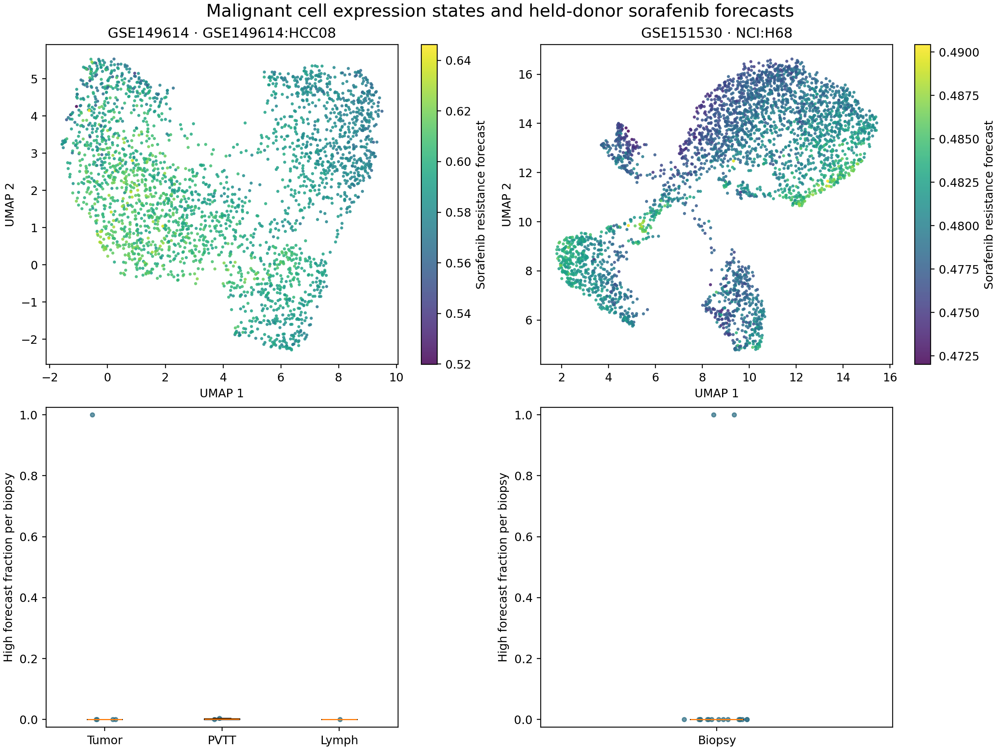

# Track 5 — patient donor-held resistance forecasts

After donor-blocked model fitting, the independent scorer examined 18,145 malignant candidate cells from 24 donors. The plot model was chosen on source validation by its mean within-drug Spearman across folds.

## Independent held cell-line pharmacology

The table averages lineage-level within-drug Spearman over measured drugs. RNA subsampling tests preservation of a measured cell-line pharmacology signal. The exact Tahoe lineage is available in the full table as a single measured expression anchor.

| query | depth | model | lineage_min | drugs_scored | within_drug_spearman |
| --- | --- | --- | --- | --- | --- |
| pseudo_bulk | 1000.0000 | ABCB1 | 74 | 5 | 0.0105 |
| pseudo_bulk | 1000.0000 | EMT | 74 | 5 | 0.0075 |
| pseudo_bulk | 1000.0000 | SCAD_family | 74 | 5 | 0.1136 |
| pseudo_bulk | 1000.0000 | elasticnet | 74 | 5 | 0.0265 |
| pseudo_bulk | 1000.0000 | elasticnet_bulk | 74 | 5 | 0.0496 |
| pseudo_bulk | 1000.0000 | hypoxia | 74 | 5 | -0.0044 |
| pseudo_bulk | 1000.0000 | lightgbm | 74 | 5 | 0.0828 |
| pseudo_bulk | 1000.0000 | lightgbm_bulk | 74 | 5 | 0.1146 |
| pseudo_bulk | 1000.0000 | mean | 74 | 5 | 0.0000 |
| pseudo_bulk | 1000.0000 | rank_mlp | 74 | 5 | -0.0003 |
| pseudo_bulk | 1000.0000 | ridge | 74 | 5 | 0.0153 |
| pseudo_bulk | 1000.0000 | ridge_bulk | 74 | 5 | 0.0251 |
| pseudo_bulk | 1000.0000 | scDEAL_family | 74 | 5 | 0.0518 |
| pseudo_bulk | 1000.0000 | scgpt_adversarial | 74 | 5 | 0.0884 |
| pseudo_bulk | 1000.0000 | scgpt_mlp_no_adaptation | 74 | 5 | -0.0332 |
| pseudo_bulk | 1000.0000 | scgpt_mmd | 74 | 5 | 0.0067 |
| pseudo_bulk | 1000.0000 | stemness | 74 | 5 | -0.0886 |
| pseudo_bulk | 4000.0000 | ABCB1 | 74 | 5 | -0.0111 |
| pseudo_bulk | 4000.0000 | EMT | 74 | 5 | -0.0307 |
| pseudo_bulk | 4000.0000 | SCAD_family | 74 | 5 | 0.0522 |
| pseudo_bulk | 4000.0000 | elasticnet | 74 | 5 | 0.0941 |
| pseudo_bulk | 4000.0000 | elasticnet_bulk | 74 | 5 | 0.1200 |
| pseudo_bulk | 4000.0000 | hypoxia | 74 | 5 | 0.0366 |
| pseudo_bulk | 4000.0000 | lightgbm | 74 | 5 | 0.1303 |
| pseudo_bulk | 4000.0000 | lightgbm_bulk | 74 | 5 | 0.1572 |
| pseudo_bulk | 4000.0000 | mean | 74 | 5 | 0.0000 |
| pseudo_bulk | 4000.0000 | rank_mlp | 74 | 5 | 0.0280 |
| pseudo_bulk | 4000.0000 | ridge | 74 | 5 | 0.0874 |
| pseudo_bulk | 4000.0000 | ridge_bulk | 74 | 5 | 0.0967 |
| pseudo_bulk | 4000.0000 | scDEAL_family | 74 | 5 | 0.1134 |
| pseudo_bulk | 4000.0000 | scgpt_adversarial | 74 | 5 | 0.0836 |
| pseudo_bulk | 4000.0000 | scgpt_mlp_no_adaptation | 74 | 5 | 0.0022 |
| pseudo_bulk | 4000.0000 | scgpt_mmd | 74 | 5 | -0.0556 |
| pseudo_bulk | 4000.0000 | stemness | 74 | 5 | -0.1514 |
| pseudo_single_cell | 1000.0000 | ABCB1 | 74 | 5 | -0.0023 |
| pseudo_single_cell | 1000.0000 | EMT | 74 | 5 | 0.0085 |
| pseudo_single_cell | 1000.0000 | SCAD_family | 74 | 5 | 0.1015 |
| pseudo_single_cell | 1000.0000 | elasticnet | 74 | 5 | 0.0793 |
| pseudo_single_cell | 1000.0000 | elasticnet_bulk | 74 | 5 | 0.1496 |
| pseudo_single_cell | 1000.0000 | hypoxia | 74 | 5 | 0.0903 |
| pseudo_single_cell | 1000.0000 | lightgbm | 74 | 5 | 0.1009 |
| pseudo_single_cell | 1000.0000 | lightgbm_bulk | 74 | 5 | 0.0941 |
| pseudo_single_cell | 1000.0000 | mean | 74 | 5 | 0.0000 |
| pseudo_single_cell | 1000.0000 | rank_mlp | 74 | 5 | -0.0535 |
| pseudo_single_cell | 1000.0000 | ridge | 74 | 5 | 0.0641 |
| pseudo_single_cell | 1000.0000 | ridge_bulk | 74 | 5 | 0.0985 |
| pseudo_single_cell | 1000.0000 | scDEAL_family | 74 | 5 | -0.0831 |
| pseudo_single_cell | 1000.0000 | scgpt_adversarial | 74 | 5 | 0.0834 |
| pseudo_single_cell | 1000.0000 | scgpt_mlp_no_adaptation | 74 | 5 | -0.0317 |
| pseudo_single_cell | 1000.0000 | scgpt_mmd | 74 | 5 | 0.0444 |
| pseudo_single_cell | 1000.0000 | stemness | 74 | 5 | -0.0029 |
| pseudo_single_cell | 4000.0000 | ABCB1 | 74 | 5 | -0.0205 |
| pseudo_single_cell | 4000.0000 | EMT | 74 | 5 | -0.0097 |
| pseudo_single_cell | 4000.0000 | SCAD_family | 74 | 5 | 0.0886 |
| pseudo_single_cell | 4000.0000 | elasticnet | 74 | 5 | 0.0668 |
| pseudo_single_cell | 4000.0000 | elasticnet_bulk | 74 | 5 | 0.1139 |
| pseudo_single_cell | 4000.0000 | hypoxia | 74 | 5 | 0.0613 |
| pseudo_single_cell | 4000.0000 | lightgbm | 74 | 5 | 0.0944 |
| pseudo_single_cell | 4000.0000 | lightgbm_bulk | 74 | 5 | 0.0963 |
| pseudo_single_cell | 4000.0000 | mean | 74 | 5 | 0.0000 |
| pseudo_single_cell | 4000.0000 | rank_mlp | 74 | 5 | -0.0755 |
| pseudo_single_cell | 4000.0000 | ridge | 74 | 5 | 0.0285 |
| pseudo_single_cell | 4000.0000 | ridge_bulk | 74 | 5 | 0.0609 |
| pseudo_single_cell | 4000.0000 | scDEAL_family | 74 | 5 | -0.0737 |
| pseudo_single_cell | 4000.0000 | scgpt_adversarial | 74 | 5 | 0.0749 |
| pseudo_single_cell | 4000.0000 | scgpt_mlp_no_adaptation | 74 | 5 | -0.0355 |
| pseudo_single_cell | 4000.0000 | scgpt_mmd | 74 | 5 | -0.0228 |
| pseudo_single_cell | 4000.0000 | stemness | 74 | 5 | -0.0668 |

## Paired sorafenib organoids

Each donor and class first averages technical replicates. The difference is the predicted resistance of organoids annotated resistant minus sensitive. The interval and randomization test use the four held-out donor pairs.

| model | donors | concordant_donors | mean | ci_low | ci_high | sign_flip_p |
| --- | --- | --- | --- | --- | --- | --- |
| ABCB1 | 4 | 2 | 0.0634 | -0.0905 | 0.2515 | 0.7500 |
| EMT | 4 | 2 | -0.0136 | -0.0304 | 0.0032 | 0.5000 |
| SCAD_family | 4 | 1 | -0.0784 | -0.1779 | -0.0131 | 0.2500 |
| elasticnet | 4 | 2 | 0.0180 | -0.0344 | 0.0704 | 0.6250 |
| elasticnet_bulk | 4 | 2 | 0.0207 | -0.0628 | 0.1265 | 0.8750 |
| hypoxia | 4 | 0 | -0.0522 | -0.0771 | -0.0311 | 0.1250 |
| lightgbm | 4 | 1 | -0.1346 | -0.2839 | -0.0106 | 0.2500 |
| lightgbm_bulk | 4 | 2 | -0.0686 | -0.1986 | 0.0613 | 0.5000 |
| mean | 4 | 0 | 0.0000 | 0.0000 | 0.0000 | 1.0000 |
| rank_mlp | 4 | 2 | -0.0246 | -0.1206 | 0.0715 | 0.7500 |
| ridge | 4 | 2 | 0.0146 | -0.0786 | 0.1079 | 0.8750 |
| ridge_bulk | 4 | 1 | 0.0048 | -0.0959 | 0.1361 | 1.0000 |
| scDEAL_family | 4 | 3 | 0.0132 | 0.0008 | 0.0256 | 0.2500 |
| scgpt_adversarial | 4 | 3 | 0.0281 | -0.0144 | 0.0815 | 0.5000 |
| scgpt_mlp_no_adaptation | 4 | 3 | 0.2222 | -0.0152 | 0.6520 | 0.3750 |
| scgpt_mmd | 4 | 1 | -0.0275 | -0.0543 | -0.0007 | 0.2500 |
| stemness | 4 | 1 | -0.0118 | -0.0464 | 0.0386 | 0.7500 |

## Site and time contrasts

Differences are within-patient changes in the fraction above a source-calibrated high-resistance threshold. The NCI time series follows ICI exposure. Sorafenib response is unmeasured in the patient biopsies.

| contrast | model | donors | mean | ci_low | ci_high | sign_flip_p |
| --- | --- | --- | --- | --- | --- | --- |
| paired_primary_to_pvtt | ABCB1 | 1 | -0.2972 | — | — | 1.0000 |
| paired_primary_to_lymph | ABCB1 | 1 | 0.0000 | — | — | 1.0000 |
| nci_paired_first_to_followup | ABCB1 | 3 | 0.0048 | -0.0013 | 0.0157 | 1.0000 |
| paired_primary_to_pvtt | EMT | 1 | -0.0171 | — | — | 1.0000 |
| paired_primary_to_lymph | EMT | 1 | 0.0370 | — | — | 1.0000 |
| nci_paired_first_to_followup | EMT | 3 | -0.0054 | -0.0166 | 0.0004 | 1.0000 |
| paired_primary_to_pvtt | SCAD_family | 1 | 0.0000 | — | — | 1.0000 |
| paired_primary_to_lymph | SCAD_family | 1 | 0.0000 | — | — | 1.0000 |
| nci_paired_first_to_followup | SCAD_family | 3 | 0.0000 | 0.0000 | 0.0000 | 1.0000 |
| paired_primary_to_pvtt | elasticnet | 1 | 0.0000 | — | — | 1.0000 |
| paired_primary_to_lymph | elasticnet | 1 | 0.0000 | — | — | 1.0000 |
| nci_paired_first_to_followup | elasticnet | 3 | -0.0018 | -0.0055 | 0.0000 | 1.0000 |
| paired_primary_to_pvtt | elasticnet_bulk | 1 | 0.0000 | — | — | 1.0000 |
| paired_primary_to_lymph | elasticnet_bulk | 1 | 0.0370 | — | — | 1.0000 |
| nci_paired_first_to_followup | elasticnet_bulk | 3 | 0.0000 | 0.0000 | 0.0000 | 1.0000 |
| paired_primary_to_pvtt | hypoxia | 1 | -0.1638 | — | — | 1.0000 |
| paired_primary_to_lymph | hypoxia | 1 | -0.0139 | — | — | 1.0000 |
| nci_paired_first_to_followup | hypoxia | 3 | -0.0057 | -0.0139 | 0.0000 | 0.5000 |
| paired_primary_to_pvtt | lightgbm | 1 | 0.0000 | — | — | 1.0000 |
| paired_primary_to_lymph | lightgbm | 1 | 0.0000 | — | — | 1.0000 |
| nci_paired_first_to_followup | lightgbm | 3 | 0.0000 | 0.0000 | 0.0000 | 1.0000 |
| paired_primary_to_pvtt | lightgbm_bulk | 1 | 0.0000 | — | — | 1.0000 |
| paired_primary_to_lymph | lightgbm_bulk | 1 | 0.0000 | — | — | 1.0000 |
| nci_paired_first_to_followup | lightgbm_bulk | 3 | 0.0000 | 0.0000 | 0.0000 | 1.0000 |
| paired_primary_to_pvtt | mean | 1 | 0.0000 | — | — | 1.0000 |
| paired_primary_to_lymph | mean | 1 | 0.0000 | — | — | 1.0000 |
| nci_paired_first_to_followup | mean | 3 | 0.0000 | 0.0000 | 0.0000 | 1.0000 |
| paired_primary_to_pvtt | rank_mlp | 1 | 0.0000 | — | — | 1.0000 |
| paired_primary_to_lymph | rank_mlp | 1 | 0.2141 | — | — | 1.0000 |
| nci_paired_first_to_followup | rank_mlp | 3 | 0.0111 | -0.0166 | 0.0500 | 1.0000 |
| paired_primary_to_pvtt | ridge | 1 | 0.0026 | — | — | 1.0000 |
| paired_primary_to_lymph | ridge | 1 | 0.0000 | — | — | 1.0000 |
| nci_paired_first_to_followup | ridge | 3 | -0.0007 | -0.0042 | 0.0022 | 1.0000 |
| paired_primary_to_pvtt | ridge_bulk | 1 | 0.0017 | — | — | 1.0000 |
| paired_primary_to_lymph | ridge_bulk | 1 | 0.0000 | — | — | 1.0000 |
| nci_paired_first_to_followup | ridge_bulk | 3 | -0.0005 | -0.0015 | 0.0000 | 1.0000 |
| paired_primary_to_pvtt | scDEAL_family | 1 | 0.0000 | — | — | 1.0000 |
| paired_primary_to_lymph | scDEAL_family | 1 | 0.0000 | — | — | 1.0000 |
| nci_paired_first_to_followup | scDEAL_family | 3 | -0.0310 | -0.0664 | 0.0000 | 0.5000 |
| paired_primary_to_pvtt | scgpt_adversarial | 1 | 0.0043 | — | — | 1.0000 |
| paired_primary_to_lymph | scgpt_adversarial | 1 | 0.0000 | — | — | 1.0000 |
| nci_paired_first_to_followup | scgpt_adversarial | 3 | 0.0000 | 0.0000 | 0.0000 | 1.0000 |
| paired_primary_to_pvtt | scgpt_mlp_no_adaptation | 1 | 0.1772 | — | — | 1.0000 |
| paired_primary_to_lymph | scgpt_mlp_no_adaptation | 1 | 0.1551 | — | — | 1.0000 |
| nci_paired_first_to_followup | scgpt_mlp_no_adaptation | 3 | -0.1020 | -0.2711 | -0.0110 | 0.2500 |
| paired_primary_to_pvtt | scgpt_mmd | 1 | 0.0000 | — | — | 1.0000 |
| paired_primary_to_lymph | scgpt_mmd | 1 | 0.1771 | — | — | 1.0000 |
| nci_paired_first_to_followup | scgpt_mmd | 3 | 0.0265 | 0.0000 | 0.0413 | 0.5000 |
| paired_primary_to_pvtt | stemness | 1 | -0.0773 | — | — | 1.0000 |
| paired_primary_to_lymph | stemness | 1 | 0.1539 | — | — | 1.0000 |
| nci_paired_first_to_followup | stemness | 3 | -0.0234 | -0.0714 | 0.0009 | 1.0000 |

## Technical and biological diagnostics for scgpt_adversarial

| kind | model | cohort | variable | donors | mean | ci_low | ci_high | sign_flip_p |
| --- | --- | --- | --- | --- | --- | --- | --- | --- |
| biological | scgpt_adversarial | GSE125449 | EMT | 5 | 0.1961 | 0.1219 | 0.2738 | 0.0625 |
| biological | scgpt_adversarial | GSE125449 | hypoxia | 5 | 0.1998 | 0.1021 | 0.3163 | 0.0625 |
| biological | scgpt_adversarial | GSE125449 | stemness | 5 | 0.0547 | -0.0363 | 0.1580 | 0.5000 |
| technical | scgpt_adversarial | GSE125449 | detected_genes | 5 | 0.3436 | 0.1250 | 0.5550 | 0.1250 |
| technical | scgpt_adversarial | GSE125449 | g2m_phase | 5 | 0.1789 | 0.0955 | 0.2562 | 0.0625 |
| technical | scgpt_adversarial | GSE125449 | mitochondrial_fraction | 5 | 0.0233 | -0.0938 | 0.1111 | 0.7500 |
| technical | scgpt_adversarial | GSE125449 | s_phase | 5 | -0.0284 | -0.2172 | 0.1331 | 0.7500 |
| technical | scgpt_adversarial | GSE125449 | umi | 5 | -0.1788 | -0.3721 | 0.0144 | 0.2500 |
| biological | scgpt_adversarial | GSE149614 | EMT | 5 | 0.1847 | 0.1237 | 0.2519 | 0.0625 |
| biological | scgpt_adversarial | GSE149614 | hypoxia | 5 | 0.2637 | 0.1671 | 0.3431 | 0.0625 |
| biological | scgpt_adversarial | GSE149614 | stemness | 5 | 0.1120 | 0.0108 | 0.2596 | 0.0625 |
| technical | scgpt_adversarial | GSE149614 | detected_genes | 5 | 0.1256 | -0.0112 | 0.2624 | 0.2500 |
| technical | scgpt_adversarial | GSE149614 | g2m_phase | 5 | 0.0433 | -0.0505 | 0.1479 | 0.7500 |
| technical | scgpt_adversarial | GSE149614 | mitochondrial_fraction | 5 | 0.1960 | -0.0469 | 0.4304 | 0.2500 |
| technical | scgpt_adversarial | GSE149614 | s_phase | 5 | -0.1308 | -0.1988 | -0.0668 | 0.0625 |
| technical | scgpt_adversarial | GSE149614 | umi | 5 | 0.0025 | -0.1714 | 0.1486 | 1.0000 |
| biological | scgpt_adversarial | GSE151530 | EMT | 14 | 0.1072 | 0.0146 | 0.1967 | 0.0480 |
| biological | scgpt_adversarial | GSE151530 | hypoxia | 14 | 0.1710 | 0.1058 | 0.2345 | 0.0009 |
| biological | scgpt_adversarial | GSE151530 | stemness | 14 | 0.0357 | -0.0161 | 0.0928 | 0.2419 |
| technical | scgpt_adversarial | GSE151530 | detected_genes | 14 | 0.2193 | 0.1079 | 0.3349 | 0.0015 |
| technical | scgpt_adversarial | GSE151530 | g2m_phase | 14 | 0.1000 | 0.0257 | 0.1682 | 0.0198 |
| technical | scgpt_adversarial | GSE151530 | mitochondrial_fraction | 14 | 0.1195 | 0.0433 | 0.1933 | 0.0132 |
| technical | scgpt_adversarial | GSE151530 | s_phase | 14 | 0.0436 | 0.0004 | 0.0913 | 0.0928 |
| technical | scgpt_adversarial | GSE151530 | umi | 14 | -0.1105 | -0.2054 | -0.0271 | 0.0364 |

## Largest absolute technical partial correlation by model and cohort

| kind | model | cohort | variable | donors | mean | ci_low | ci_high | sign_flip_p |
| --- | --- | --- | --- | --- | --- | --- | --- | --- |
| technical | scgpt_mmd | GSE151530 | mitochondrial_fraction | 14 | 0.3461 | 0.2335 | 0.4558 | 0.0004 |
| technical | scgpt_adversarial | GSE125449 | detected_genes | 5 | 0.3436 | 0.1250 | 0.5550 | 0.1250 |
| technical | scgpt_mmd | GSE125449 | mitochondrial_fraction | 5 | 0.3411 | 0.2546 | 0.5063 | 0.0625 |
| technical | EMT | GSE125449 | umi | 5 | -0.2833 | -0.4072 | -0.1906 | 0.0625 |
| technical | scgpt_mmd | GSE149614 | mitochondrial_fraction | 5 | 0.2820 | -0.0787 | 0.5099 | 0.1875 |
| technical | EMT | GSE149614 | g2m_phase | 5 | -0.2402 | -0.3184 | -0.1354 | 0.0625 |
| technical | hypoxia | GSE151530 | detected_genes | 14 | 0.2277 | 0.1784 | 0.2852 | 0.0001 |
| technical | lightgbm | GSE125449 | detected_genes | 5 | 0.2256 | 0.1421 | 0.3715 | 0.0625 |
| technical | scgpt_adversarial | GSE151530 | detected_genes | 14 | 0.2193 | 0.1079 | 0.3349 | 0.0015 |
| technical | hypoxia | GSE149614 | g2m_phase | 5 | -0.2173 | -0.2790 | -0.1706 | 0.0625 |
| technical | EMT | GSE151530 | mitochondrial_fraction | 14 | 0.2014 | 0.1325 | 0.2724 | 0.0002 |
| technical | scgpt_mlp_no_adaptation | GSE125449 | g2m_phase | 5 | 0.2013 | 0.0655 | 0.3372 | 0.1250 |
| technical | scgpt_adversarial | GSE149614 | mitochondrial_fraction | 5 | 0.1960 | -0.0469 | 0.4304 | 0.2500 |
| technical | ABCB1 | GSE125449 | umi | 5 | -0.1901 | -0.3057 | -0.0615 | 0.1250 |
| technical | lightgbm | GSE149614 | detected_genes | 5 | 0.1868 | 0.1341 | 0.2669 | 0.0625 |
| technical | stemness | GSE125449 | umi | 5 | -0.1756 | -0.2130 | -0.1259 | 0.0625 |
| technical | ABCB1 | GSE151530 | detected_genes | 14 | -0.1608 | -0.3349 | -0.0182 | 0.0645 |
| technical | elasticnet_bulk | GSE149614 | umi | 5 | -0.1589 | -0.2590 | -0.0600 | 0.0625 |
| technical | scgpt_mlp_no_adaptation | GSE149614 | g2m_phase | 5 | 0.1545 | -0.0491 | 0.3603 | 0.3750 |
| technical | hypoxia | GSE125449 | detected_genes | 5 | 0.1493 | 0.0815 | 0.2619 | 0.0625 |
| technical | ridge | GSE149614 | umi | 5 | -0.1433 | -0.2262 | -0.0536 | 0.1250 |
| technical | lightgbm_bulk | GSE149614 | umi | 5 | -0.1421 | -0.1730 | -0.1171 | 0.0625 |
| technical | ridge | GSE125449 | s_phase | 5 | 0.1399 | 0.0364 | 0.2603 | 0.1250 |
| technical | elasticnet | GSE149614 | umi | 5 | -0.1385 | -0.2043 | -0.0632 | 0.0625 |
| technical | scgpt_mlp_no_adaptation | GSE151530 | detected_genes | 14 | 0.1364 | 0.0191 | 0.2577 | 0.0624 |
| technical | lightgbm | GSE151530 | detected_genes | 14 | 0.1349 | 0.0847 | 0.1846 | 0.0010 |
| technical | ridge_bulk | GSE125449 | s_phase | 5 | 0.1309 | -0.0157 | 0.2842 | 0.3125 |
| technical | stemness | GSE151530 | umi | 14 | -0.1242 | -0.1610 | -0.0871 | 0.0001 |
| technical | rank_mlp | GSE149614 | detected_genes | 5 | 0.1210 | 0.0098 | 0.2177 | 0.1875 |
| technical | ridge_bulk | GSE149614 | umi | 5 | -0.1188 | -0.1728 | -0.0613 | 0.0625 |
| technical | stemness | GSE149614 | s_phase | 5 | -0.1038 | -0.1499 | -0.0600 | 0.0625 |
| technical | rank_mlp | GSE125449 | s_phase | 5 | 0.0982 | -0.0070 | 0.1955 | 0.1875 |
| technical | scDEAL_family | GSE149614 | umi | 5 | -0.0834 | -0.1330 | -0.0252 | 0.1250 |
| technical | scDEAL_family | GSE125449 | s_phase | 5 | -0.0822 | -0.1394 | -0.0250 | 0.2500 |
| technical | SCAD_family | GSE125449 | mitochondrial_fraction | 5 | -0.0812 | -0.1468 | -0.0181 | 0.1875 |
| technical | SCAD_family | GSE149614 | detected_genes | 5 | 0.0801 | 0.0020 | 0.1583 | 0.1875 |
| technical | ABCB1 | GSE149614 | g2m_phase | 5 | 0.0783 | 0.0190 | 0.1421 | 0.1250 |
| technical | elasticnet | GSE125449 | detected_genes | 5 | 0.0771 | -0.0647 | 0.2071 | 0.3125 |
| technical | lightgbm_bulk | GSE125449 | umi | 5 | 0.0732 | -0.0496 | 0.1959 | 0.3125 |
| technical | scDEAL_family | GSE151530 | g2m_phase | 14 | -0.0599 | -0.0861 | -0.0331 | 0.0012 |
| technical | ridge | GSE151530 | g2m_phase | 14 | 0.0591 | 0.0135 | 0.1057 | 0.0310 |
| technical | elasticnet_bulk | GSE125449 | detected_genes | 5 | 0.0578 | -0.0246 | 0.1677 | 0.3750 |
| technical | SCAD_family | GSE151530 | umi | 14 | 0.0576 | 0.0279 | 0.0859 | 0.0035 |
| technical | elasticnet | GSE151530 | umi | 14 | -0.0519 | -0.1041 | -0.0028 | 0.0786 |
| technical | lightgbm_bulk | GSE151530 | umi | 14 | -0.0431 | -0.1380 | 0.0358 | 0.3918 |
| technical | elasticnet_bulk | GSE151530 | mitochondrial_fraction | 14 | 0.0411 | -0.0043 | 0.0887 | 0.1110 |
| technical | ridge_bulk | GSE151530 | detected_genes | 14 | -0.0322 | -0.0992 | 0.0301 | 0.3538 |
| technical | rank_mlp | GSE151530 | umi | 14 | 0.0266 | -0.0485 | 0.0942 | 0.4877 |

## Malignant cell UMAP and resistance fraction

The display uses the measured scGPT coordinates in one densely observed donor per cohort. Transcriptional states come from expression-space clustering. No genomic clonality assay was performed on these states.

